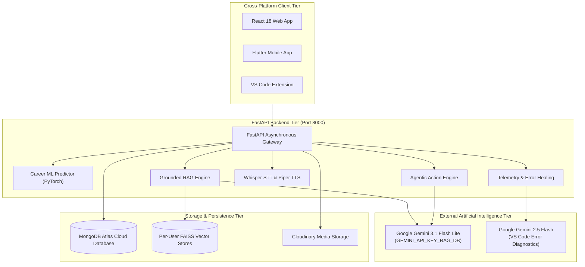

# MirrorMind — Comprehensive Technical Architecture & System Documentation

Welcome to the central technical documentation suite for **MirrorMind**, an AI-powered career trajectory prediction, academic document intelligence (RAG), and developer telemetry ecosystem.

This repository directory contains exhaustive, deep-dive architectural documents detailing every layer, subsystem, data structure, workflow, and model in the project.

---

## Documentation Navigation Index

| Document | Scope & Contents | Primary Technologies |
|---|---|---|
| 📑 **[overall_architecture.md](file:///c:/Users/ASUS/Desktop/Projects/MirrorMind/report/overall_architecture.md)** | **Overall System Architecture & Ecosystem Topology** • Executive Summary & Vision • System Component Matrix & Ports • Full System Mermaid Architecture Diagram • Complete End-to-End Sequence Diagram • Database Schemas (MongoDB collections: users, students, chunks, logs) • Security, Key Management & Vector Isolation | FastAPI, React, Flutter, VS Code, MongoDB Atlas, FAISS, PyTorch, Gemini |
| ⚙️ **[backend_detail.md](file:///c:/Users/ASUS/Desktop/Projects/MirrorMind/report/backend_detail.md)** | **Backend Services, ML & RAG Engine Specification** • FastAPI Application Lifecycle & Middleware • Complete 12-Router API Catalog (45+ endpoints) • Career Trajectory ML Pipeline (`predictor.py`, `CareerMLP`, Softmax) • Document Processing & FAISS Vector Store (`vector_store.py`) • Grounded RAG & Context Budgeting (`rag_service.py`) • Dual LLM Architecture (Local Ollama vs Cloud OpenRouter) • Real-Time Voice Services (Whisper STT & Piper Neural TTS) • Telemetry & Gemini 2.5 Flash Healing Services | Python, FastAPI, Motor, PyTorch, SentenceTransformers, FAISS, Piper ONNX, Whisper |
| 💻 **[frontend_detail.md](file:///c:/Users/ASUS/Desktop/Projects/MirrorMind/report/frontend_detail.md)** | **Web Application Architecture & Component Deep Dive** • React 18 + Vite Architecture & Directory Layout • Global Contexts (`AuthContext`, `DevConsoleContext`) • Neo-Brutalist & Glassmorphic Design System (`index.css`) • Complete Page Walkthrough (Onboarding, Dashboard, Predict, Profile, etc.) • Core Interactive Subsystems (`Intelligence.jsx`, `ActionPanel.jsx`) • Hands-Free Voice Machine & Wake-Word Detection | React 18, Vite, React Router DOM, Axios, Web Audio API, Web Speech API, Lucide |
| 📱 **[mobile_app_detail.md](file:///c:/Users/ASUS/Desktop/Projects/MirrorMind/report/mobile_app_detail.md)** | **Cross-Platform Flutter Mobile Application Specification** • Flutter Architecture & Project Layout (`mobile-app/lib`) • Provider State Architecture (6 Core Providers) • Persistent Navigation Shell (`MainScaffold`) • Screen-by-Screen Breakdown (Home, Predict, Docs, AI Voice, Profile) • Mobile Document Picker & Cloudinary Direct Upload • Mobile Hands-Free Voice Engine & Quick Prompts • Neo-Brutalist Mobile Theme & Component Library | Flutter 3.x, Dart, Provider, FilePicker, Cloudinary, SpeechToText, FlutterTTS |
| 🔌 **[vscode_extension_detail.md](file:///c:/Users/ASUS/Desktop/Projects/MirrorMind/report/vscode_extension_detail.md)** | **VS Code Telemetry Extension (Skillgap Monitor) Specification** • Extension Architecture & Life Cycle (`src/extension.ts`) • VS Code SecretStorage Key Handshake • File Save Event Listener (`onDidSaveTextDocument`) • AST Diagnostic Filtering & 7-Line Context Extractor • SHA-256 Deduplication Fingerprinting Engine • Automated AI Healing Cycle with Google Gemini 2.5 Flash • Two-Tier Web Dashboard Resolution (Hint vs Reveal Fix) • Packaging, Commands, and Configuration Options | TypeScript, VS Code Extension API, esbuild, Node.js Crypto, Gemini 2.5 Flash |
| 🔄 **[features_and_workflow_guide.md](file:///c:/Users/ASUS/Desktop/Projects/MirrorMind/report/features_and_workflow_guide.md)** | **Features Catalog, Operational Workflows & System Logics** • 15-Feature Master Catalog (Inputs, Logic, Outputs, Benefits) • **Workflow 1**: Onboarding & ML Career Prediction • **Workflow 2**: Document Ingestion, Chunking & Vector Indexing • **Workflow 3**: Grounded Academic RAG Query Execution • **Workflow 4**: Agentic Multi-Turn Profile Actions • **Workflow 5**: Real-Time IDE Telemetry & Gemini AI Repair • **Workflow 6**: Multi-Modal Voice Interaction & Hands-Free Loop • **Workflow 7**: Developer ML Pipeline Transparency & Inspection • **Workflow 8**: Cross-Platform Web & Mobile Synchronization | Mermaid Workflow Diagrams, Logic Flows, State Transitions |

---

## System Architectural Topology Summary

