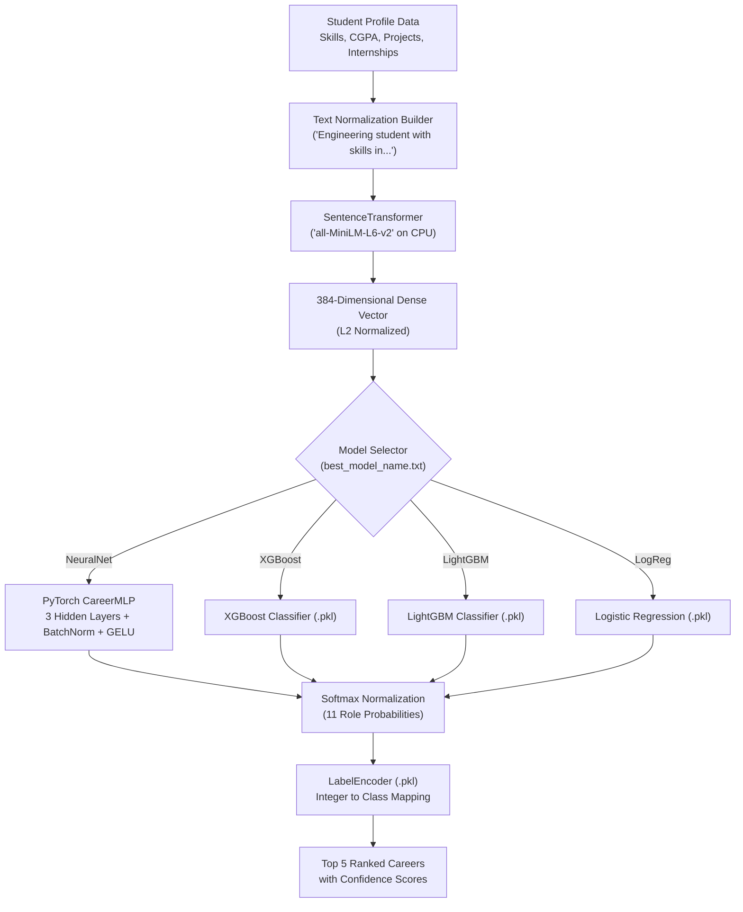
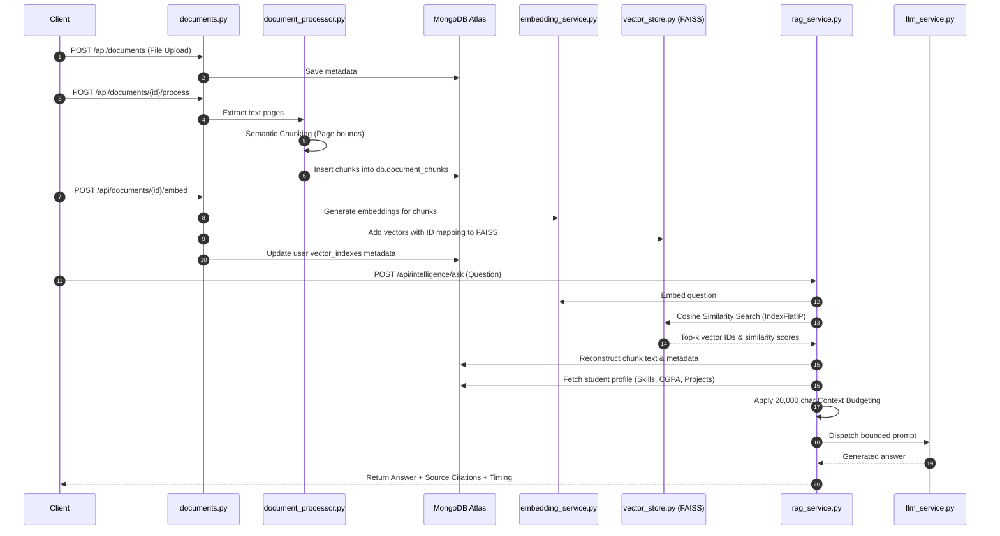
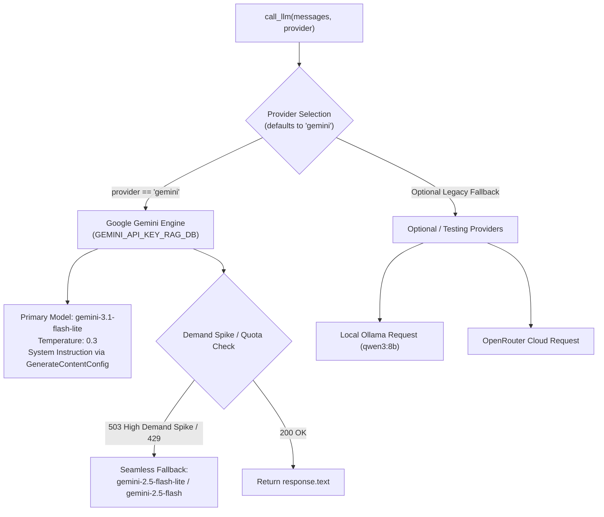
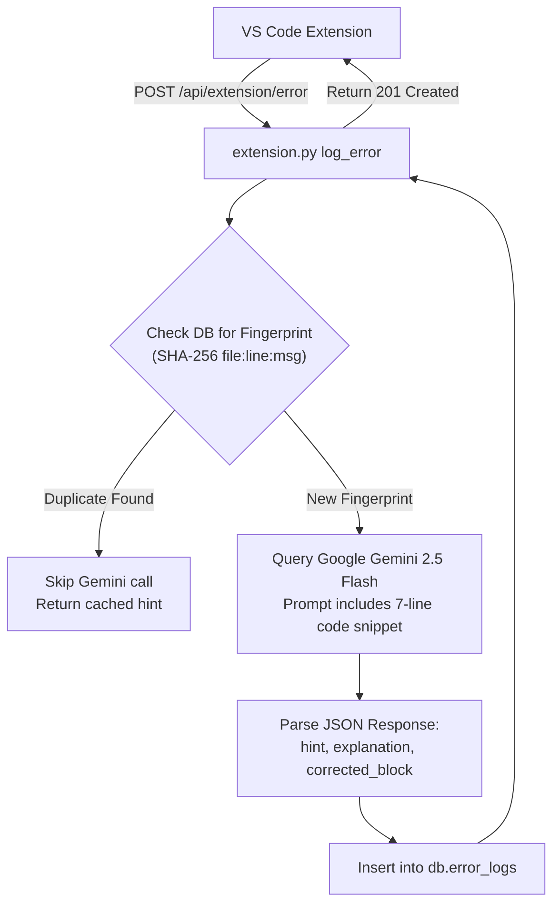

# MirrorMind — In-Depth Backend Architecture & Subsystems Specification

## 1. Backend Server Architecture & Lifecycle

The MirrorMind backend is an asynchronous, high-performance web service built with **Python 3.10+** and **FastAPI**, served via **Uvicorn**. It acts as the central orchestration hub for database operations, machine learning inference, vector retrieval, external LLM calls, and real-time developer telemetry.

### 1.1 Application Entrypoint (`backend/main.py`)
* **Framework**: FastAPI (Version 1.0.0).
* **Startup Lifecycle**:
  ```python
  @app.on_event("startup")
  async def startup_event():
      await setup_indexes()
  ```
  On server boot, `setup_indexes()` connects to MongoDB via the Motor async driver and guarantees the creation of compound index `[("user_id", 1), ("document_id", 1)]` on the `document_chunks` collection to optimize sub-millisecond retrieval.
* **CORS Middleware**:
  Configured to permit local development and production deployments:
  - `http://localhost:5173` (React Vite local frontend)
  - `http://localhost:3000` (React CRA / Next.js)
  - `https://mirrormindai.vercel.app` (Vercel production domain)
  - `https://dawdlingly-pseudoinsane-pa.ngrok-free.dev` (Public ngrok tunneling for testing and mobile/extension callbacks)
  - Wildcard fallback with credentials allowed.

---

## 2. Complete REST & WebSocket Router Inventory

The backend organizes all capabilities into 12 modular routers under `/api`:

```mermaid
graph LR
    subgraph RouterTree["FastAPI App (/api)"]
        AUTH["/auth (Authentication)"]
        STUDENTS["/students (Profiles & Portfolios)"]
        PREDICT["/predict (ML Predictions)"]
        DOCS["/documents (Document Management)"]
        RETRIEVAL["/retrieval (Vector Search)"]
        INTEL["/intelligence (RAG Engine)"]
        ACTIONS["/actions (Agentic Normalization)"]
        VOICE["/voice (STT & TTS)"]
        EXT["/extension (VS Code Telemetry)"]
        SETTINGS["/settings (API Keys)"]
        DEV["/developer (Pipeline Visualizer)"]
        UPLOADS["/upload (Cloudinary Signing)"]
    end
```



### 2.1 Route Catalog & Specification Table

| Router | Method | Path | Authentication | Description |
|---|---|---|---|---|
| **Auth** | POST | `/api/auth/register` | Public | Registers a new user account with name, email, and password. |
| **Auth** | POST | `/api/auth/login` | Public | Verifies credentials, returns Bearer JWT. |
| **Students** | GET | `/api/students/profile` | Bearer JWT | Retrieves the current user's profile, including embedded projects & internships. |
| **Students** | POST | `/api/students/profile` | Bearer JWT | Creates or updates student academic profile (branch, semester, CGPA, skills). |
| **Students** | PATCH | `/api/students/profile/avatar` | Bearer JWT | Updates user avatar image URL. |
| **Students** | GET | `/api/students/skills` | Public | Returns static catalogue of standard engineering skills. |
| **Students** | GET | `/api/students/projects` | Bearer JWT | Lists all user projects. |
| **Students** | POST | `/api/students/projects` | Bearer JWT | Adds a new project to the student's embedded array. |
| **Students** | PUT | `/api/students/projects/{id}` | Bearer JWT | Updates an existing project. |
| **Students** | DELETE | `/api/students/projects/{id}` | Bearer JWT | Removes a project from student profile. |
| **Students** | PATCH | `/api/students/projects/{id}/thumbnail` | Bearer JWT | Updates project thumbnail URL. |
| **Students** | GET | `/api/students/internships` | Bearer JWT | Lists user internships. |
| **Students** | POST | `/api/students/internships` | Bearer JWT | Adds a new internship record. |
| **Students** | DELETE | `/api/students/internships/{id}` | Bearer JWT | Deletes an internship. |
| **Students** | PATCH | `/api/students/internships/{id}/certificate` | Bearer JWT | Attaches a certificate URL to an internship. |
| **Predict** | GET | `/api/predict` | Bearer JWT | Runs ML career prediction or serves cached prediction (`?force=true` bypasses cache). |
| **Predict** | POST | `/api/predict/refresh` | Bearer JWT | Clears cached predictions and forces recalculation. |
| **Documents** | POST | `/api/documents` | Bearer JWT | Uploads a PDF (max 10MB), creates DB metadata, stores local copy. |
| **Documents** | GET | `/api/documents` | Bearer JWT | Lists all uploaded documents and processing statuses for user. |
| **Documents** | GET | `/api/documents/{id}` | Bearer JWT | Retrieves document details. |
| **Documents** | GET | `/api/documents/{id}/download` | Bearer JWT | Downloads document file from server or redirects to Cloudinary. |
| **Documents** | DELETE | `/api/documents/{id}` | Bearer JWT | Deletes document, MongoDB chunks, and FAISS vectors. |
| **Documents** | POST | `/api/documents/{id}/process` | Bearer JWT | Extracts text, performs semantic chunking, stores chunks in DB. |
| **Documents** | GET | `/api/documents/{id}/status` | Bearer JWT | Returns processing and chunking status. |
| **Documents** | POST | `/api/documents/{id}/embed` | Bearer JWT | Generates embeddings for chunks and inserts vectors into FAISS. |
| **Retrieval** | POST | `/api/retrieval/search` | Bearer JWT | Directly executes Cosine similarity vector search over user FAISS index. |
| **Intelligence**| POST | `/api/intelligence/ask` | Bearer JWT | Executes full Grounded RAG query (Retrieval + Profile + Budget + LLM). |
| **Actions** | POST | `/api/actions/normalize` | Bearer JWT | Normalizes unstructured wizard data into strict Pydantic JSON via LLM. |
| **Voice** | POST | `/api/voice/transcribe` | Bearer JWT | Whisper STT endpoint: accepts WAV audio, returns transcript. |
| **Voice** | POST | `/api/voice/synthesize` | Bearer JWT | Piper TTS endpoint: accepts text, returns WAV audio. |
| **Voice** | WS | `/api/voice/ws/tts` | Public / Token | Real-time WebSocket streaming of 16-bit raw PCM audio chunks. |
| **Extension** | POST | `/api/extension/verify-key` | `X-Extension-Key` | Validates VS Code extension API key. |
| **Extension** | POST | `/api/extension/activity` | `X-Extension-Key` | Logs file save events from developer IDE. |
| **Extension** | POST | `/api/extension/error` | `X-Extension-Key` | Logs syntax/compilation error, fingerprints, queries Gemini for fixes. |
| **Extension** | GET | `/api/extension/errors` | Bearer JWT | Fetches active or history errors for dashboard display. |
| **Extension** | GET | `/api/extension/errors/{id}/reveal` | Bearer JWT | Retrieves full Gemini explanation and corrected code block. |
| **Extension** | PATCH | `/api/extension/errors/{id}/resolve` | Bearer JWT | Marks error as solved via `hint` or `full_fix`. |
| **Extension** | DELETE | `/api/extension/errors/{id}` | Bearer JWT | Hides error from history. |
| **Settings** | GET | `/api/settings/api-key` | Bearer JWT | Checks if active extension key exists, returns masked prefix. |
| **Settings** | POST | `/api/settings/api-key` | Bearer JWT | Generates new extension key, returns plaintext token once. |
| **Settings** | POST | `/api/settings/api-key/regenerate` | Bearer JWT | Revokes old key and issues new token. |
| **Developer** | GET | `/api/developer/demo` | Public | Returns mock ML pipeline demo for showcase. |
| **Developer** | GET | `/api/developer/my-pipeline` | Bearer JWT | Returns live ML pipeline internals for user (text, vector, softmax). |
| **Uploads** | GET | `/api/upload/config` | Bearer JWT | Returns Cloudinary public cloud name and presets. |
| **Uploads** | GET | `/api/upload/sign` | Bearer JWT | Generates cryptographic HMAC-SHA1 signature for direct client uploads. |

---

## 3. Career Trajectory Machine Learning Subsystem

The Career Prediction engine is implemented in `backend/inference/predictor.py` and wrapped by `backend/routes/predict.py`.



### 3.1 Profile Text Normalization
To prevent keyword memorization and data leakage, the student's raw data is compiled into a standardized natural language sentence:
```python
def build_profile_text(skills: list, cgpa: float = None, projects: int = None, internships: int = None) -> str:
    skills_clean = [str(s).strip().lower() for s in skills if s]
    if skills_clean:
        text = f"Engineering student with skills in {', '.join(skills_clean)}."
    else:
        text = "Engineering student with technical skills."
    if cgpa is not None:
        text += f" CGPA {float(cgpa):.1f}."
    extras = []
    if projects is not None:
        extras.append(f"{int(projects)} projects")
    if internships is not None:
        extras.append(f"{int(internships)} internship(s)")
    if extras:
        text += f" Completed {' and '.join(extras)}."
    return text.strip()
```

### 3.2 Semantic Embedding Pipeline
* **Model**: `all-MiniLM-L6-v2` via HuggingFace `sentence-transformers`.
* **Output Vector**: 384-dimensional dense floating-point array.
* **Normalization**: Vectors are normalized to unit length ($L_2$ norm), ensuring vector products represent cosine similarity.

### 3.3 Active Neural Network Architecture (`CareerMLP`)
The production model is a deep Multi-Layer Perceptron implemented in PyTorch (`nn_best.pt`):
```python
class CareerMLP(nn.Module):
    def __init__(self, input_dim=384, num_classes=11, dropout=0.35):
        super().__init__()
        self.net = nn.Sequential(
            nn.Linear(input_dim, 512),
            nn.BatchNorm1d(512),
            nn.GELU(),
            nn.Dropout(dropout),
            
            nn.Linear(512, 256),
            nn.BatchNorm1d(256),
            nn.GELU(),
            nn.Dropout(dropout),
            
            nn.Linear(256, 128),
            nn.BatchNorm1d(128),
            nn.GELU(),
            nn.Dropout(dropout * 0.7),
            
            nn.Linear(128, num_classes)
        )

    def forward(self, x):
        return self.net(x)
```
* **Loss Function during training**: CrossEntropyLoss with Label Smoothing.
* **Activation**: GELU (Gaussian Error Linear Units) for smoother gradient flow compared to ReLU.
* **Regularization**: Batch Normalization and Dropout between 0.245 and 0.35.

### 3.4 Target Career Roles
Predictions classify into 11 distinct industry roles:
1. `AIML_ENGINEER`: AI / Machine Learning Engineer
2. `DATA_ANALYST`: Data Analyst
3. `SWE_BACKEND`: Backend Developer
4. `SWE_FRONTEND`: Frontend Developer
5. `FULLSTACK` / `FULLSTACK_DEV`: Full Stack Developer
6. `DEVOPS_CLOUD`: DevOps / Cloud Infrastructure Engineer
7. `DATA_ENGINEER`: Big Data Engineer
8. `CYBERSECURITY`: Cybersecurity Specialist
9. `EMBEDDED` / `EMBEDDED_IOT`: Embedded Systems & IoT Engineer
10. `RESEARCH`: R&D / Research Engineer
11. `PRODUCT_MANAGER`: Technical Product Manager

### 3.5 Skill Radar & Top Insight Computation
In addition to ML probabilities, the backend computes a multi-dimensional competency radar:
$$\text{Technical Depth} = \min(100, \text{advanced\_skills\_count} \times 20)$$
$$\text{Breadth} = \min(100, \text{total\_skills\_count} \times 8)$$
$$\text{Project Exp} = \min(100, \text{projects\_count} \times 20)$$
$$\text{Industry Exp} = \min(100, \text{internships\_count} \times 40)$$
$$\text{Academic} = \min\left(100, \left\lfloor\frac{\text{CGPA}}{10.0} \times 100\right\rfloor\right)$$

---

## 4. Grounded Academic RAG & Document Intelligence Subsystem

The RAG pipeline operates across four coordinated services: `documents.py`, `vector_store.py`, `retrieval_service.py`, and `rag_service.py`.



### 4.1 Document Ingestion & Chunking
* **Supported Formats**: PDF (with extensible architecture for docx/txt).
* **Parser**: Fast, high-fidelity PDF extraction via `PyMuPDF` (`fitz`) and `pdfplumber`.
* **Chunking Strategy**: Semantic chunking preserving sentence boundaries with page range metadata (`page_start`, `page_end`), chunk indices, and parent document ID.

### 4.2 Vector Store Architecture (`vector_store.py`)
* **Underlying Engine**: Facebook AI Similarity Search (**FAISS**).
* **Index Type**: `IndexFlatIP` (Exact Inner Product Search) wrapped in `IndexIDMap` to enable runtime vector deletions by ID.
* **Metric**: Because all embeddings are normalized to $\|v\| = 1$, Inner Product is mathematically identical to **Cosine Similarity**:
  $$\text{Cosine Similarity}(u, v) = \frac{u \cdot v}{\|u\| \|v\|} = u \cdot v$$
* **Physical Isolation**:
  Vector stores are stored on disk under `backend/vector_indexes/{user_id}/`:
  - `index.faiss`: Serialized binary FAISS index.
  - `metadata.json`: Key-value map from integer vector IDs to `{user_id, document_id, chunk_id, page_start, page_end}`.
  This physical segregation ensures zero vector leakages across users.

### 4.3 Context Budget Management & Prompt Assembly (`rag_service.py`)
To prevent token overflows and maintain high signal-to-noise ratios, the RAG service enforces a hard context budget:
* **Max Context Characters**: Configurable via `RAG_MAX_CONTEXT_CHARS` (Default: **20,000 characters**).
* **Assembly Priority**:
  1. System Prompt (Guardrails & instructions)
  2. Student Profile (CGPA, Branch, Semester, Skills, Projects, Internships, Career Predictions)
  3. User Question
  4. Retrieved Document Sources (appended incrementally by descending similarity score until budget is reached).
  5. If adding another chunk exceeds the budget, `context_truncated` is flagged and chunking halts safely.

---

## 5. Multi-Provider LLM Integration (`llm_service.py`)

MirrorMind implements a unified LLM service with **Google Gemini 3.1 Flash Lite** as the primary, default engine for all Grounded RAG queries, student DB details, and conversational action structuring:



### 5.1 Primary Cloud Engine (Google Gemini 3.1 Flash Lite)
* **Configuration**: Key defined in environment variable `GEMINI_API_KEY_RAG_DB` (with fallback to `GEMINI_API_KEY`).
* **Active Model**: `gemini-3.1-flash-lite` (configurable via `GEMINI_RAG_MODEL`).
* **Execution**: Run asynchronously via `asyncio.to_thread` to ensure zero blocking of the FastAPI event loop during high-concurrency requests.
* **Resilience**: If Google servers experience a temporary demand spike (HTTP 503) on 3.1 Flash Lite, the service automatically routes to candidate models (`gemini-2.5-flash-lite`), ensuring zero service interruption.
* **Responsibilities**:
  - Grounded Academic RAG query answering across student profile data and FAISS chunks.
  - Profile information retrieval and database question answering.
  - Action wizard normalization (`ADD_PROJECT`, `ADD_INTERNSHIP`) into strict Pydantic JSON.

### 5.2 Optional Testing Providers (Ollama & OpenRouter)
* Code remains available as secondary fallbacks if explicitly requested via query parameter, but the entire platform defaults to Google Gemini.


---

## 6. Agentic Action Normalization Engine (`actions.py`)

MirrorMind supports conversational mutations to student profiles. When a user completes a voice or text wizard (e.g. adding a project or internship), the collected answers may contain conversational text:
* User says: *"I used react, tailwind and fast api, github is github dot com slash my repo"*
* LLM Normalization Engine processes this via `/api/actions/normalize`:
```json
{
  "title": "Smart Attendance System",
  "description": "Face recognition based student attendance logging.",
  "tech_stack": ["React", "Tailwind CSS", "FastAPI"],
  "github_url": "https://github.com/my-repo",
  "live_demo_url": null
}
```
* Rules enforced:
  - `tech_stack` must be parsed into clean individual string arrays.
  - Conversational dates ("June 2024 to ongoing") must be converted into ISO-8601 strings (`2024-06-01T00:00:00Z`) with `is_current: 1`.
  - Output is strictly JSON with zero markdown wrapping.

---

## 7. Real-Time Voice & Audio Pipeline (`voice.py` & `voice_service.py`)

### 7.1 Speech-to-Text (STT)
* **Model**: `openai/whisper-tiny` running locally on CPU.
* **Input**: 16-bit mono PCM WAV bytes.
* **Pipeline**: HuggingFace `automatic-speech-recognition` pipeline.
* **Audio Formatting**: Converts 16-bit signed integer frames into normalized $\pm 1.0$ float32 arrays before passing into Whisper.

### 7.2 Text-to-Speech (TTS) & Real-Time Streaming
* **Engine**: **Piper Neural TTS** (`en_US-lessac-medium` ONNX model).
* **Modes**:
  1. **HTTP Audio Synthesis (`POST /api/voice/synthesize`)**: Synthesizes complete sentences into standard WAV audio buffers.
  2. **WebSocket Streaming (`WS /api/voice/ws/tts`)**: Runs Piper in a background thread executor using `synthesize_stream_raw`, pushing raw 16-bit PCM byte chunks to the client as they are generated. A special token `__END__` signals playback completion.

---

## 8. VS Code Extension Services & Gemini AI Healing (`extension.py`)

The backend interfaces with the developer's VS Code environment through dedicated endpoints protected by `X-Extension-Key`:



* **Deduplication**: Error fingerprints are generated as `SHA256(filePath + ":" + line + ":" + message)`. If a developer saves a file repeatedly without fixing the line, Gemini is only invoked once, conserving API quota.
* **Gemini 2.5 Flash Integration**:
  Uses `google-genai` SDK with prompt grounding:
  ```text
  Here is a snippet of Python code with an error on line {line}:
  {code_context}
  The error is: {error_message} (source: {source}).
  Respond with JSON only: {"hint": "...", "explanation": "...", "corrected_block": "..."}
  where corrected_block is the corrected version of ONLY the erroring line/block.
  ```
* **Error Life Cycle Management**:
  - `GET /api/extension/errors?status=active`: Returns active issues with AI hints.
  - `GET /api/extension/errors/{id}/reveal`: Returns full explanation and corrected code.
  - `PATCH /api/extension/errors/{id}/resolve`: Marks issue resolved via `hint` or `full_fix`.
  - `DELETE /api/extension/errors/{id}`: Soft-deletes error (`hidden_by_user: true`).
