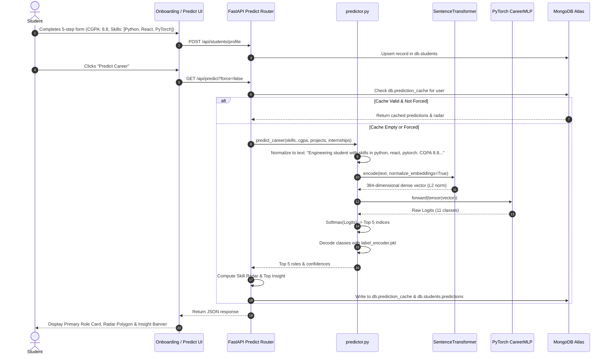
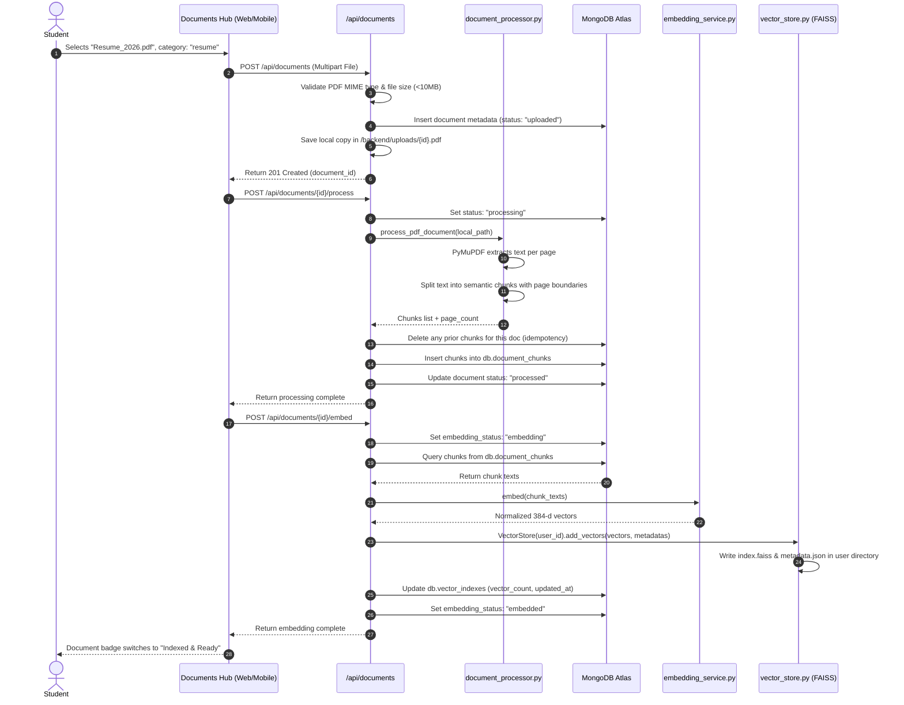
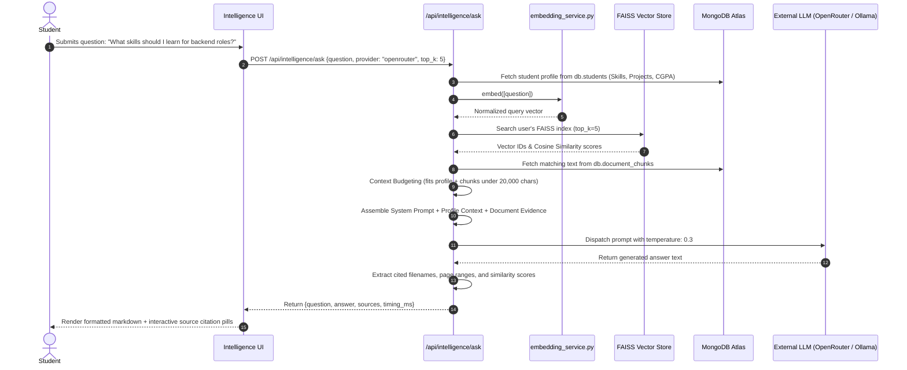
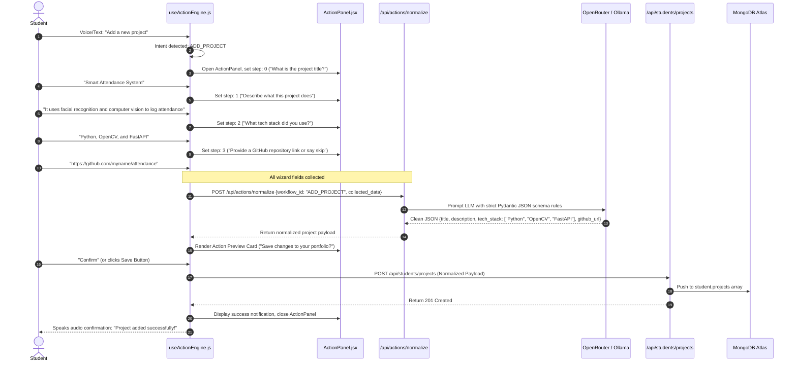
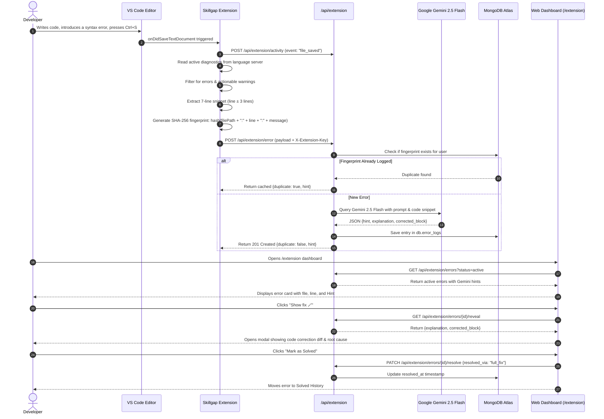
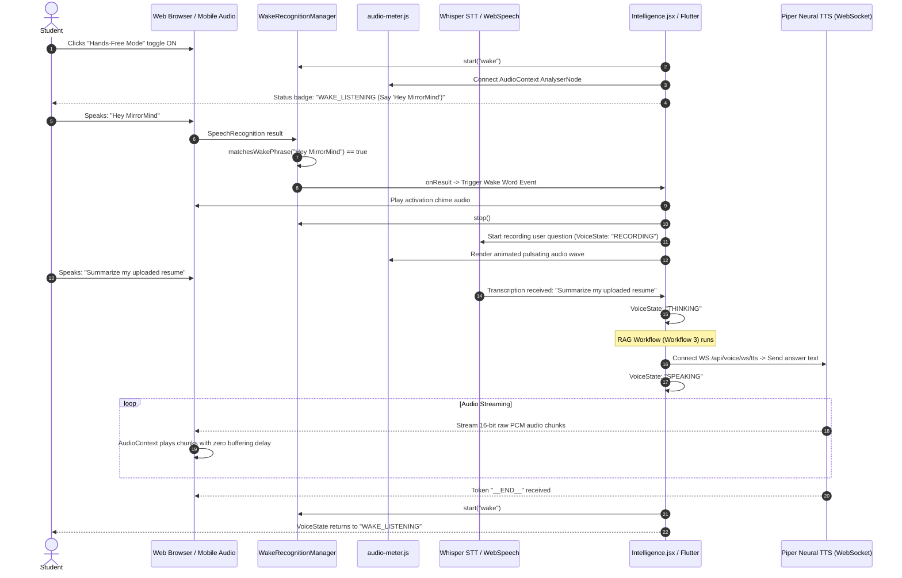
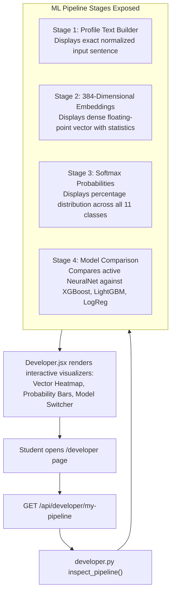
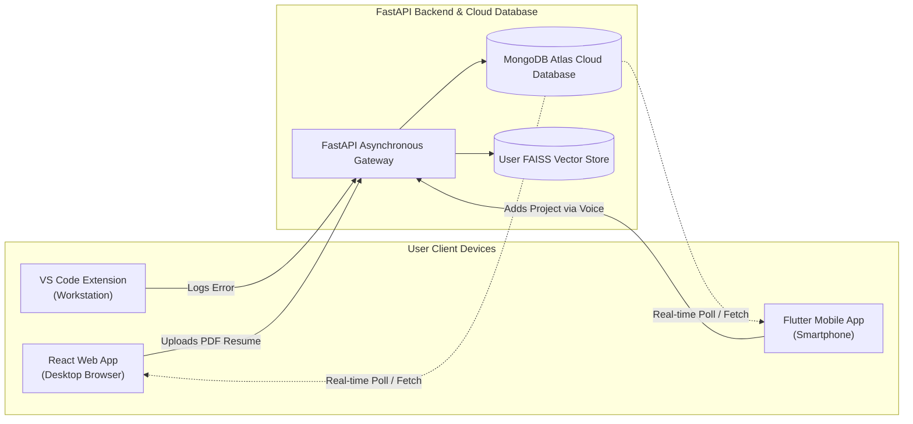

# MirrorMind — Features Catalog, Operational Workflows & System Logics

## 1. Comprehensive Features Catalog

MirrorMind provides an integrated suite of artificial intelligence features designed to assist engineering students at every stage of their academic and professional development.

| # | Feature Name | Description | Key Inputs | Core Engine / Service | Output / Deliverable |
|---|---|---|---|---|---|
| **F-01** | **Career Trajectory Prediction** | Evaluates student profile to predict top-5 best-fit industry career roles with confidence probabilities. | Skills, CGPA, Projects count, Internships count | PyTorch `CareerMLP`, SentenceTransformer `all-MiniLM-L6-v2`, `predictor.py` | Top-5 ranked career roles, confidence scores, primary role card. |
| **F-02** | **Skill Competency Radar** | Visualizes student proficiency across 6 dimensions to evaluate engineering readiness. | Profile skills, academic CGPA, completed projects, internships | Algorithmic normalization in `routes/predict.py` | 6-axis SVG / Canvas polygon (Depth, Breadth, Projects, Industry, Academic, Soft Skills). |
| **F-03** | **Actionable Career Insights** | Dynamically generates strategic recommendations based on prediction gaps. | Prediction ranks, confidence percentages, skill array | Heuristic rules engine in `routes/predict.py` | Contextual advice banner (e.g., *"Add PyTorch and Docker to hit 85%+ confidence"*). |
| **F-04** | **Academic Document Processing** | Ingests PDF resumes, transcripts, project reports, and certificates. | Uploaded PDF files (max 10MB) | PyMuPDF (`fitz`), `pdfplumber`, `document_processor.py` | Clean text chunks with page bounds, stored in `db.document_chunks`. |
| **F-05** | **Per-User Isolated Vector Search** | Indexes document chunks for sub-millisecond semantic retrieval without cross-user leakage. | Normalized chunk text embeddings | FAISS (`IndexFlatIP` + `IndexIDMap`) in `services/vector_store.py` | Isolated on-disk vector index (`index.faiss`) per user. |
| **F-06** | **Grounded Academic RAG** | Answers complex student questions using their own profile and uploaded documents with strict anti-hallucination. | User query string, top-k chunks, student profile | `rag_service.py`, `llm_service.py` (Ollama / OpenRouter) | Factual markdown answer accompanied by verified source citations. |
| **F-07** | **Context Budget Management** | Enforces strict 20,000 character context windows to prevent token overflows and hallucinations. | Retrieved document chunks, system prompt, profile | Priority sliding window in `services/rag_service.py` | Optimal prompt budget allocation with truncation flags. |
| **F-08** | **Hands-Free Wake-Word Voice Assistant** | Continuous voice listening activated by saying *"Hey MirrorMind"*, with audio chimes and voice playback. | Microphone audio stream, wake phrases | `WakeRecognitionManager`, Web Audio API, `audio-meter.js` | Hands-free hands-off voice interaction loop. |
| **F-09** | **Real-Time Speech Synthesis (TTS)** | High-quality neural voice playback for AI answers. | Generated answer text | Piper Neural TTS (ONNX) via WebSockets (`/ws/tts`) & Web Speech API fallback | Streamed 16-bit PCM audio or browser voice output. |
| **F-10** | **Speech-to-Text Transcription (STT)**| Local offline voice transcription. | Raw WAV audio recordings | HuggingFace `openai/whisper-tiny` pipeline in `voice_service.py` | Accurate natural language text transcript. |
| **F-11** | **Agentic Profile Mutations** | Voice and text conversational wizards to add projects, internships, or edit profile fields. | Conversational statements (e.g., *"Add project"*, *"Change CGPA"*) | `useActionEngine.js`, `intentDetector.js`, `actions.py` | LLM-normalized Pydantic JSON committed to MongoDB. |
| **F-12** | **IDE Coding Telemetry & AI Healing** | Captures syntax and runtime errors on file save in VS Code, retrieves Gemini AI hints and code fixes. | File save events, compiler diagnostics, 7-line snippet | VS Code Extension (`extension.ts`), Google Gemini 2.5 Flash | Real-time AI hint cards and revealable code corrections on web dashboard. |
| **F-13** | **SHA-256 Error Deduplication** | Prevents repeated API calls and saves AI tokens during iterative debugging. | File path, line number, error message | SHA-256 hashing in `extension.ts` & backend check | Cached duplicate recognition and instant hint response. |
| **F-14** | **Developer ML Pipeline Visualizer** | Exposes inner mathematical workings of the machine learning pipeline for educational transparency. | Student profile data | `Developer.jsx`, `routes/developer.py` | Step-by-step vector inspector, raw sentence view, and 11-class Softmax breakdown. |
| **F-15** | **Cloudinary Media Infrastructure** | Secure cloud storage for project thumbnails and internship completion certificates. | Image files (JPEG, PNG) | Signed/Unsigned Cloudinary API integration in `routes/uploads.py` | Persistent CDN URLs stored in student documents. |

---

## 2. Operational Workflows & System Logics

---

### Workflow 1: Student Onboarding & Career Trajectory Prediction

This workflow transforms raw student academic credentials into dense semantic vector representations, executes neural network inference, and renders the top career predictions.

---

### Workflow 2: Document Ingestion, Semantic Chunking & FAISS Vector Indexing

This workflow enables students to upload academic documents (resumes, transcripts, project reports), extracts textual content, partitions it into semantic chunks, and creates a private FAISS vector index.

---

### Workflow 3: Grounded Academic RAG Query Execution

This workflow executes an anti-hallucination, citation-backed query answering cycle combining the student's live profile with retrieved document evidence.

---

### Workflow 4: Agentic Multi-Turn Profile Actions

This workflow enables users to execute profile modifications (e.g., adding a project or internship) conversationally via voice or text with strict structured JSON normalization.

---

### Workflow 5: Real-Time IDE Coding Telemetry & Automated AI Repair

This workflow links developer coding actions in VS Code to the web dashboard, diagnosing syntax/runtime errors and generating fixes via Google Gemini 2.5 Flash.

---

### Workflow 6: Multi-Modal Voice Interaction & Hands-Free Audio Loop

This workflow details the continuous speech recognition, wake-word activation, query routing, and real-time audio playback cycle.

---

### Workflow 7: Developer ML Pipeline Transparency & Inspection

This workflow allows students and instructors to inspect the exact mathematical stages of career prediction inside `/developer`.

---

### Workflow 8: Cross-Platform Web & Mobile Synchronization

This workflow illustrates how state changes performed on one client reflect instantaneously across all other devices.

* **Unified Profile State**: A project added via voice on the mobile app is immediately visible on the web dashboard projects list.
* **Unified Document & Vector Hub**: A PDF transcript uploaded on the desktop web app is immediately searchable via voice RAG on the mobile phone.
* **Unified Coding Error Feed**: An error caught in VS Code appears in real-time on both the web telemetry page and the mobile notification dashboard.
