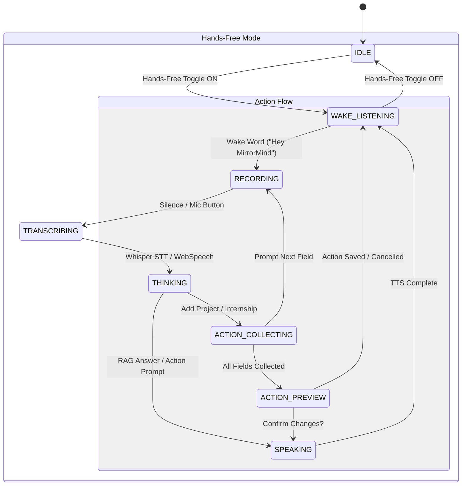

# MirrorMind — Frontend Web Application Architecture & Component Deep Dive

## 1. Frontend Architecture & Technology Stack

The MirrorMind web application is a single-page application (SPA) built with **React 18** and bundled using **Vite**. It provides a reactive, aesthetic user interface that connects engineering students to machine learning predictions, grounded academic RAG search, multi-modal voice interactions, and live VS Code coding telemetry.

### 1.1 Core Technology Stack
* **Framework**: React 18.x
* **Build Tool & Dev Server**: Vite 5.x (`npm run dev` at `http://localhost:5173`)
* **Routing**: React Router DOM v6
* **HTTP Client**: Axios with centralized request/response interceptors
* **Icons**: Lucide React
* **Speech Synthesis & Recognition**: Web Speech API (`webkitSpeechRecognition`, `speechSynthesis`), HTML5 Web Audio API (`AudioContext`, `AnalyserNode`), and WebSocket binary streaming.
* **Styling**: Neo-Brutalist / Vibrant Glassmorphism design system using Vanilla CSS tokens in `src/index.css`.

---

## 2. Directory Structure & Organization

```text
frontend/src/
├── api/
│   └── axios.js                 # Configured Axios instance with Bearer token injection
├── assets/                      # Static logos, avatars, and graphics
├── components/
│   ├── ActionPanel.jsx          # Multi-turn wizard & normalization review panel
│   ├── DeveloperConsole.jsx     # Slide-out ML pipeline inspector
│   ├── DocumentViewer.jsx       # Modal PDF reader with page controls
│   ├── Documents.jsx            # Document upload hub, status list & chunking manager
│   ├── InsightBanner.jsx        # Smart recommendation callout
│   ├── Intelligence.jsx         # Conversational RAG & voice state machine (45KB core)
│   ├── MainLayout.jsx           # Sidebar navigation, topbar & layout shell
│   ├── PredictionCards.jsx      # Top-5 career recommendations with progress bars
│   ├── PrimaryRoleCard.jsx      # #1 Ranked career highlight with circular score ring
│   ├── SkillRadarChart.jsx      # SVG-rendered 6-axis skill competency radar
│   ├── StepProgress.jsx         # Multi-step onboarding indicator
│   ├── VoiceDiagnosticsPanel.jsx # Live debugging panel for audio levels and states
│   └── VoiceStatePanel.jsx      # Visual status badge and audio wave visualizer
├── context/
│   ├── AuthContext.jsx          # User session, JWT persistence, login/logout handlers
│   └── DevConsoleContext.jsx    # Developer debugging state provider
├── hooks/
│   └── useActionEngine.js       # Finite state machine managing voice/text action workflows
├── pages/
│   ├── Dashboard.jsx            # Student home dashboard with embedded AI features
│   ├── Developer.jsx            # Full-page ML pipeline transparency console
│   ├── Extension.jsx            # VS Code coding telemetry and AI error feed
│   ├── Internships.jsx          # Internship portfolio CRUD and certificate viewer
│   ├── Login.jsx                # User login screen
│   ├── Onboarding.jsx           # 5-Step progressive student onboarding wizard
│   ├── Predict.jsx              # Full career prediction & readiness analysis page
│   ├── Profile.jsx              # Comprehensive student profile editor
│   ├── Projects.jsx             # Technical projects showcase and repo linker
│   ├── Register.jsx             # Account registration page
│   └── Settings.jsx             # VS Code extension API key provisioning & revocation
├── utils/
│   ├── actionWorkflows.js       # Workflow step definitions (Add Project, Internship, etc.)
│   ├── audio-meter.js           # Real-time Web Audio API RMS audio meter
│   ├── browser-tts.js           # Browser SpeechSynthesis fallback engine
│   ├── commandNormalizer.js     # Natural language text pre-processor for voice commands
│   ├── intentDetector.js        # Zero-LLM regex and Levenshtein intent classifier
│   ├── record-audio.js          # MediaRecorder audio capture utility
│   ├── streaming-tts.js         # WebSocket client for 16-bit raw PCM streaming from Piper
│   └── wake-recognition.js      # Continuous "Hey MirrorMind" wake-word manager
├── App.jsx                      # Route configurations & application providers
├── index.css                    # Neo-brutalist theme, layout utilities, animations
└── main.jsx                     # DOM root mount
```

---

## 3. Global State Management & Authentication Flow

### 3.1 Authentication Context (`src/context/AuthContext.jsx`)
* **State Variables**: `user`, `token`, `loading`, `isAuthenticated`.
* **Token Persistence**: JWT is saved in browser `localStorage.getItem('token')`.
* **Axios Interceptor (`src/api/axios.js`)**:
  Automatically injects the stored JWT into the `Authorization` header of every outgoing HTTP request:
  ```javascript
  api.interceptors.request.use((config) => {
    const token = localStorage.getItem('token');
    if (token) {
      config.headers.Authorization = `Bearer ${token}`;
    }
    return config;
  });
  ```
* **Auto-Logout on 401**: Interceptor catches `401 Unauthorized` responses and cleans up invalid credentials, redirecting the user to `/login`.

### 3.2 Route Guarding Architecture
* **`PublicRoute`**: Accessible only when unauthenticated (redirects active users to `/dashboard`).
* **`PrivateRoute`**: Blocks unauthenticated access and redirects to `/login`.
* **`MainLayout`**: Persistent application shell featuring topbar user details, active route highlighting, and standard padding.

---

## 4. UI / UX Design System (Neo-Brutalist & Vibrant Glassmorphism)

The visual design system is defined in `frontend/src/index.css`. It features clean typography, vibrant accent colors, high-contrast borders, and playful micro-animations:

| Design Token | CSS Variable | Hex Value | Usage |
|---|---|---|---|
| **Border Dark** | `--border-black` | `#0f172a` | 2px to 3px solid borders on cards and buttons. |
| **Card White** | `--card-bg` | `#ffffff` | Background for primary surface cards. |
| **Mint Green** | `--accent-mint` | `#10b981` | Success states, primary CTA buttons, active status. |
| **Lavender** | `--accent-lavender`| `#818cf8` | Active navigation items, secondary badges, AI icons. |
| **Warm Yellow** | `--accent-yellow` | `#fbbf24` | Highlight banners, warnings, academic score callouts. |
| **Coral Red** | `--accent-coral` | `#f87171` | Delete buttons, errors, active voice recording indicators. |
| **Card Shadow** | `--neo-shadow` | `4px 4px 0px #0f172a` | Hard drop-shadow giving tactile retro feel. |

---

## 5. Page-by-Page Detailed Walkthrough

### 5.1 Onboarding Wizard (`src/pages/Onboarding.jsx`)
A 5-step interactive wizard designed to eliminate onboarding friction while capturing all metadata needed for machine learning inference:
1. **Step 1: Academic Basics**: Name, Branch (CSE, IT, ECE, AI/DS, etc.), Current Semester (1-8), College Tier (Tier 1/2/3).
2. **Step 2: Performance Metrics**: CGPA (0.0 to 10.0), Active Backlog Count (0+).
3. **Step 3: Technical Skills**: Tag-based input with instant auto-suggestions (Python, React, PyTorch, Docker, etc.).
4. **Step 4: Experience & Projects**: Initial project and internship counters with optional deep records.
5. **Step 5: Soft Skills & Work Preferences**: Communication rating (1-10) and preferred work style (collaborative, independent, remote).
* **"Test Profile" Button**: Injects a pre-filled, realistic sample student profile in 1 click for testing and demo purposes.

### 5.2 Dashboard (`src/pages/Dashboard.jsx`)
The central landing hub for students:
* **Hero Banner**: Displays personal greeting, current semester badge, and academic CGPA badge.
* **Quick Stats Grid**: 4 stat cards showing live counts of Projects, Internships, Technical Skills, and CGPA.
* **Prediction Teaser Card**: Interactive banner with glowing "View Predictions ✨" button leading to `/predict`.
* **Embedded Intelligence**: Direct integration of `<Intelligence />` for voice and text academic inquiries.
* **Embedded Document Hub**: Direct integration of `<Documents />` for rapid PDF uploads and chunk inspection.

### 5.3 Career Prediction Page (`src/pages/Predict.jsx`)
A visual breakdown of the student's career trajectory:
* **Primary Role Card (`PrimaryRoleCard.jsx`)**: Highlights the #1 best-fit career (e.g. *AI / ML Engineer*) with a circular SVG confidence ring and matching badge.
* **Ranked Recommendations (`PredictionCards.jsx`)**: Displays ranks 2 through 5 with animated progress bars and percentage indicators.
* **Skill Radar Chart (`SkillRadarChart.jsx`)**: Interactive SVG polygon displaying 6 competency axes: Technical Depth, Skill Breadth, Project Experience, Industry Experience, Academic Score, and Soft Skills.
* **Actionable Insight Banner (`InsightBanner.jsx`)**: Dynamic AI guidance based on prediction confidence (e.g. *"Add Docker and PyTorch to reach 85%+ confidence for ML roles"*).
* **Refresh Action**: Allows forcing recalculation to bypass cache if profile skills were updated.

### 5.4 Projects & Internships (`src/pages/Projects.jsx`, `Internships.jsx`)
* Full CRUD modals with title, description, technology tags, GitHub URLs, live links, and company roles.
* Cloudinary direct image upload widget for project thumbnails and internship completion certificates.

### 5.5 Telemetry & Error Healing (`src/pages/Extension.jsx`)
Displays real-time coding errors captured from the user's VS Code editor:
* **Status Filter**: Toggle between "Active Errors" and "History (Solved)".
* **Error Cards**: Show file path, line number, compiler/linter source (e.g. `Pylance`), error code, and timestamp.
* **AI Hint**: Concise one-line clue generated by Gemini 2.5 Flash.
* **"Show Fix 🪄" Modal**: Triggers `/api/extension/errors/{id}/reveal`, displaying:
  1. A clear natural language explanation of the root cause.
  2. A syntax-highlighted code block containing the exact corrected code.
* **Resolution**: Students can click "Mark as Solved" which archives the error into history.

### 5.6 Developer ML Pipeline Visualizer (`src/pages/Developer.jsx`)
A transparency console showing the exact data transformations in the ML inference pipeline:
1. **Raw Profile String**: Shows the formatted natural language sentence built by `predictor.py`.
2. **Dense Vector Inspector**: Visualizes the 384-dimensional floating point embedding generated by `all-MiniLM-L6-v2`.
3. **Softmax Distribution**: Renders live probability bars for all 11 target classes, verifying why the #1 role was selected over alternatives.

---

## 6. Core Interactive Subsystems & Components

### 6.1 Academic Intelligence & Grounded RAG (`src/components/Intelligence.jsx`)

`Intelligence.jsx` is a comprehensive 45KB interactive module managing conversational RAG, multi-stage loading, voice recognition, and hands-free control.



#### Key Capabilities:
1. **Wake-Word Detection (`WakeRecognitionManager`)**:
   Runs continuous low-power speech recognition listening specifically for *"Hey MirrorMind"* or *"MirrorMind"*. When detected, an audio chime triggers, and the voice state transitions to `RECORDING`.
2. **Multi-Stage Loading Animation**:
   While RAG executes, the UI displays dynamic progress steps:
   - 🔎 *Understanding your question*
   - 📚 *Searching your profile and documents*
   - 🧠 *Building personalized context*
   - ☁ *Asking OpenRouter* / 💻 *Waking up Local Ollama*
   - ✨ *Preparing your answer*
3. **Transparent Source Citations**:
   When answers draw from uploaded PDFs, citation pills appear beneath the answer showing:
   - File name (e.g. `Resume_Prajwal.pdf`)
   - Page range (`Page 1 - 2`)
   - Cosine Similarity Score (`84% relevance`)
   Clicking a citation opens the document in the inline reader.
4. **Dual TTS Output**:
   - **Streaming Mode**: Streams 16-bit PCM bytes via WebSocket from Piper Neural TTS (`en_US-lessac-medium`).
   - **Fallback Mode**: Instant client-side speech synthesis via Web Speech API (`speechSynthesis`).

### 6.2 Agentic Action Engine (`src/components/ActionPanel.jsx` & `useActionEngine.js`)
Enables conversational execution of system workflows without navigating away:
* **Supported Workflows**:
  - `ADD_PROJECT`: Multi-turn wizard (Title → Description → Tech Stack → GitHub URL → Normalize → Save).
  - `ADD_INTERNSHIP`: Multi-turn wizard (Company → Role → Domain → Dates → Normalize → Save).
  - `EDIT_PROFILE`: Directly updates specific profile fields (e.g. *"Change my CGPA to 9.1"*).
  - `OPEN_DOCUMENT`: Automatically matches and opens requested PDFs in the viewer.
  - `NAVIGATE`: Voice-controlled routing to any page in the application.
* **Deterministic Guardrails**: Prompts user with a preview before executing any database mutations.
