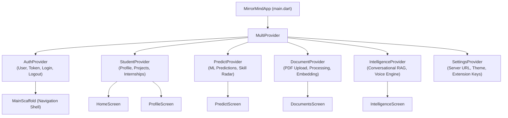

# MirrorMind — Cross-Platform Flutter Mobile Application Specification

## 1. Mobile Application Architecture & Technology Stack

The MirrorMind Mobile Application is a cross-platform client built with **Flutter 3.x** and **Dart**. It provides full feature parity with the web dashboard, allowing students to access career predictions, manage their portfolios, upload academic documents, and interact with the conversational AI and voice assistant on iOS, Android, and mobile web.

### 1.1 Technology Stack & Dependencies (`pubspec.yaml`)
* **Framework**: Flutter 3.x (Dart 3.x)
* **State Management**: **Provider Pattern** (`provider: ^6.1.1`)
* **HTTP & API Client**: Custom `ApiService` built on `http` with token injection and dynamic server URL configuration.
* **Document Picker**: `file_picker: ^8.0.0` (for picking PDF resumes, transcripts, and certificates).
* **Media & Cloud Uploads**: Custom `CloudinaryService` for unsigned direct uploads of thumbnails and certificates.
* **Audio & Speech**: `speech_to_text` and `flutter_tts` for mobile voice input and output.
* **External Links**: `url_launcher: ^6.2.5` (for opening GitHub repositories and live project demos).
* **Local Persistence**: `shared_preferences: ^2.2.2` (persisting JWT tokens, server URL, and user preferences).

---

## 2. Directory Structure & Layout

```text
mobile-app/lib/
├── core/
│   ├── constants/
│   │   └── api.dart             # API endpoint definitions and default base URLs
│   ├── services/
│   │   ├── api_service.dart     # HTTP client singleton with Bearer token interceptor
│   │   ├── cloudinary_service.dart # Direct Cloudinary upload handler
│   │   └── voice_service.dart   # Mobile speech recognition and TTS controller
│   └── theme/
│       └── app_theme.dart       # Neo-Brutalist design system (colors, borders, shadows)
├── models/
│   ├── document_model.dart      # Document metadata and chunking status model
│   ├── intelligence_model.dart  # Chat message, source citation, and action models
│   ├── predict_model.dart       # ML predictions, role labels, and confidence models
│   └── student_model.dart       # Student profile, projects, and internships models
├── providers/
│   ├── auth_provider.dart       # Authentication state, login, registration, token storage
│   ├── document_provider.dart   # PDF upload, status polling, processing, and embedding
│   ├── intelligence_provider.dart # Conversational RAG, voice loop, and quick prompts
│   ├── predict_provider.dart    # Career prediction fetching, caching, and refresh
│   ├── settings_provider.dart   # Server URL configuration and theme settings
│   └── student_provider.dart    # Student profile CRUD, stats, and portfolio arrays
├── screens/
│   ├── auth/
│   │   ├── login_screen.dart    # User login screen
│   │   └── register_screen.dart # User registration screen
│   ├── documents/
│   │   └── documents_screen.dart # Document management hub and PDF uploader
│   ├── home/
│   │   └── home_screen.dart     # Mobile home dashboard and quick stats
│   ├── intelligence/
│   │   └── intelligence_screen.dart # AI RAG assistant with hands-free voice mode
│   ├── internships/
│   │   └── internships_screen.dart # Internship portfolio and certificates
│   ├── main/
│   │   └── main_scaffold.dart   # Persistent bottom navigation container
│   ├── onboarding/
│   │   └── onboarding_screen.dart # Multi-step student profile onboarding
│   ├── predict/
│   │   └── predict_screen.dart  # Top career predictions and skill radar
│   ├── profile/
│   │   └── profile_screen.dart  # Student profile view and editor
│   ├── projects/
│   │   └── projects_screen.dart # Project cards and repository links
│   └── settings/
│       └── settings_screen.dart # Backend URL settings and API key inspector
├── widgets/
│   ├── neo_card.dart            # Custom container with hard 3px border and 4px shadow
│   ├── source_citation_card.dart # RAG source citation pill with page numbers
│   └── status_badge.dart        # Pill badge for uploaded/processing/embedded states
└── main.dart                    # Application entrypoint & MultiProvider setup
```

---

## 3. State Management Architecture (Provider Pattern)

The mobile app employs the **Provider** pattern for reactive, decoupled state management. All providers are registered at the application root in `lib/main.dart` using `MultiProvider`:



### 3.1 Core Providers Breakdown

1. **`AuthProvider`**:
   - Manages user session state and token persistence via `SharedPreferences`.
   - Automatically initializes `ApiService` with the stored Bearer token upon application launch.
   - Provides `login(email, password)`, `register(name, email, password)`, and `logout()`.

2. **`StudentProvider`**:
   - Fetches and stores the full student profile from `/api/students/profile`.
   - Tracks project count, internship count, technical skills list, and CGPA.
   - Manages additions, updates, and deletions of project and internship entities.

3. **`PredictProvider`**:
   - Calls `/api/predict` to retrieve the latest ML career rankings.
   - Supports force-refreshing to trigger real-time re-inference on the backend.
   - Caches predictions locally for instant offline rendering.

4. **`DocumentProvider`**:
   - Manages the document lifecycle: `uploadDocument(file, category)`, `processDocument(id)`, `embedDocument(id)`, and `deleteDocument(id)`.
   - Implements automated status polling for documents undergoing asynchronous background processing.

5. **`IntelligenceProvider`**:
   - Handles conversational message history with role-based formatting (`user` vs `assistant`).
   - Supports multi-provider querying (`openrouter` vs `ollama`).
   - Orchestrates the mobile voice loop: Speech-to-Text transcription, automated submission, and Text-to-Speech audio playback.
   - Manages Hands-Free Mode and quick-prompt dispatching.

---

## 4. Main Navigation Shell (`MainScaffold`)

The mobile user experience centers around `MainScaffold` (`lib/screens/main/main_scaffold.dart`), which provides a persistent, styled bottom navigation bar using an `IndexedStack` to maintain screen state during tab transitions:

| Tab Index | Tab Title | Icon | Target Screen | Purpose |
|---|---|---|---|---|
| **0** | Home | `Icons.home_rounded` | `HomeScreen` | Overview of student profile, quick stats, and recent actions. |
| **1** | AI Voice | `Icons.mic_rounded` | `IntelligenceScreen` | Conversational RAG, hands-free voice assistant, and source explorer. |
| **2** | Predict | `Icons.auto_awesome_rounded` | `PredictScreen` | Top-5 ML career recommendations and skill competency analysis. |
| **3** | Docs | `Icons.folder_shared_rounded` | `DocumentsScreen` | Uploading PDFs, monitoring chunking, and managing vector index status. |
| **4** | Profile | `Icons.person_rounded` | `ProfileScreen` | Comprehensive student academic metrics and portfolio manager. |

---

## 5. Screen-by-Screen Walkthrough

### 5.1 Home Screen (`HomeScreen`)
* **Hero Card**: Neo-Brutalist card displaying student name, branch, semester, and college tier.
* **Metric Counter Tiles**: 4 tactile cards with bold numbers showing Projects, Internships, Skills, and CGPA.
* **Career Prediction Banner**: High-contrast card with an interactive button navigating directly to the Predict view.
* **Quick Actions Row**: Shortcuts to "Ask AI Voice", "Upload Resume", or "Add New Project".

### 5.2 Mobile Intelligence & Voice Screen (`IntelligenceScreen`)
The mobile intelligence screen (`lib/screens/intelligence/intelligence_screen.dart`) is a 24KB stateful interface providing conversational RAG with full speech integration:
* **Hands-Free Mode Toggle**: Positioned in the AppBar. When enabled, the app continuously listens for questions and automatically reads responses aloud using TTS.
* **Quick Prompts Carousel**: Horizontal list of one-tap prompts:
  - *"What are my strongest skills according to my profile?"*
  - *"How ready am I for a Backend Developer role?"*
  - *"Summarize my uploaded documents and achievements."*
  - *"What should I add to my resume to target AI/ML roles?"*
* **Chat Message Feed**: Displays user bubbles (mint accent) and assistant responses (white neo-card with markdown parsing).
* **Source Citation Pills (`SourceCitationCard`)**: Tappable badges at the bottom of AI answers showing source document title, page numbers, and cosine similarity percentages.
* **Voice Mic Button**: Floating action button that activates the native microphone for voice input.

### 5.3 Document Hub Screen (`DocumentsScreen`)
The mobile document screen (`lib/screens/documents/documents_screen.dart`) manages user files:
* **Document Picker**: Integrates `FilePicker` to select local PDF files.
* **Category Selector Dialog**: Prompts user to classify document as:
  - 📄 *Resume / CV*
  - 📊 *Academic Transcript*
  - 🏆 *Certificate*
  - 📁 *Project Report*
  - 📑 *Other Document*
* **Document Card List**: Each card displays file name, file size in KB/MB, upload date, and a `StatusBadge`:
  - `uploaded`: File saved on server.
  - `processing`: Extracting text and generating chunks.
  - `processed`: Chunks created (displays page and chunk counts).
  - `embedded`: Vectors indexed in FAISS and ready for RAG.
  - `failed`: Displays processing or embedding error message.
* **Action Buttons**: Single-tap triggers for "Process", "Embed in Vector Store", "Download/View", and "Delete".

### 5.4 Career Prediction Screen (`PredictScreen`)
* **Top Role Hero**: Prominently displays the #1 recommended role (e.g. *AI / ML Engineer*) with a confidence ring indicator.
* **Prediction Breakdown**: Vertical list of the top 5 predicted career paths with animated percentage progress bars.
* **Skill Radar Visualization**: Custom canvas rendering the 6 competency metrics (Depth, Breadth, Projects, Industry, Academics, Soft Skills).
* **Insight Banner**: Real-time advice on which skills to learn to maximize career readiness.

---

## 6. Mobile Design System & Styling Architecture (`AppTheme`)

The mobile styling is implemented in `lib/core/theme/app_theme.dart` and adheres to MirrorMind's signature Neo-Brutalist aesthetic:

```dart
class AppTheme {
  static const Color borderBlack = Color(0xFF0F172A);
  static const Color cardWhite = Color(0xFFFFFFFF);
  static const Color mint = Color(0xFF10B981);
  static const Color lavender = Color(0xFF818CF8);
  static const Color yellow = Color(0xFFFBBF24);
  static const Color coral = Color(0xFFF87171);
  
  static final List<BoxShadow> cardShadow = [
    BoxShadow(
      color: borderBlack,
      offset: const Offset(4, 4),
      blurRadius: 0,
    ),
  ];
  
  static BoxDecoration neoBoxDecoration({Color color = cardWhite, double radius = 16}) {
    return BoxDecoration(
      color: color,
      borderRadius: BorderRadius.circular(radius),
      border: Border.all(color: borderBlack, width: 3),
      boxShadow: cardShadow,
    );
  }
}
```

* **Tactile Interactions**: Buttons and cards depress on tap with slight offset transforms to simulate physical switches.
* **High Contrast**: Solid 3px black borders provide exceptional readability in bright outdoor sunlight conditions.
