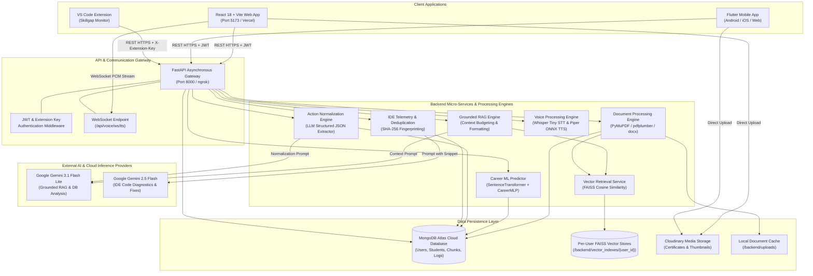
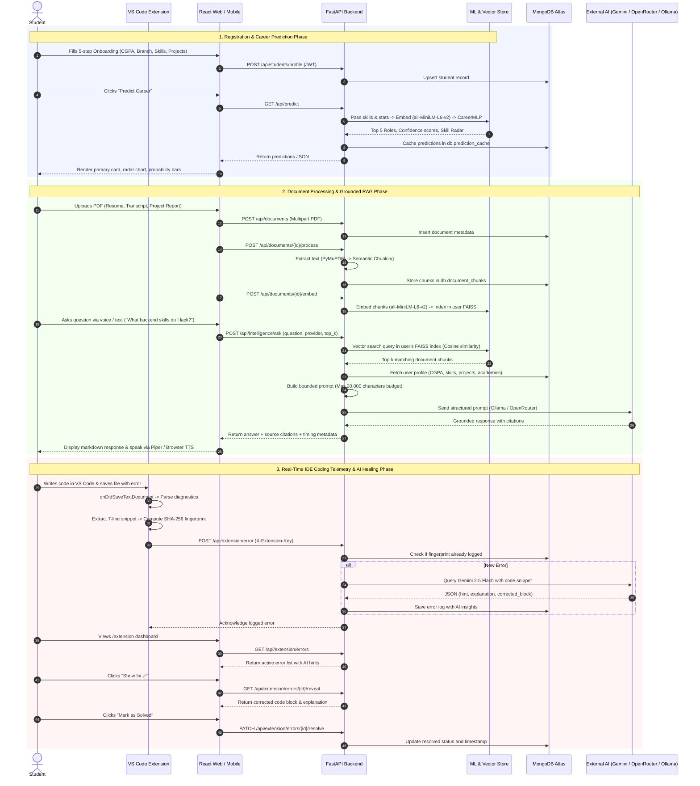

# MirrorMind — Comprehensive System Architecture & Ecosystem Overview

## 1. Executive Summary & Project Purpose

**MirrorMind** is an advanced, multi-modal, cross-platform artificial intelligence ecosystem designed specifically for engineering and computer science students. It bridges the gap between academic education, software development practice, and industry career readiness.

MirrorMind integrates five core technological pillars into a single unified platform:
1. **Machine Learning Career Trajectory Engine**: Predicts top career paths (from 11 engineering domains) based on academic records, technical skills, project portfolios, and internship experience.
2. **Grounded Academic RAG & Document Intelligence**: Ingests, semantically chunks, and indexes student documents (resumes, transcripts, project reports, certificates) into an isolated vector database (FAISS) for factual, citation-backed AI query answering.
3. **Agentic Voice & Multi-Turn Action Engine**: Enables hands-free, wake-word-activated ("Hey MirrorMind") voice interactions that can execute navigation, document inspection, and structured profile mutations (adding projects, internships, editing profile details).
4. **Real-Time IDE Telemetry & AI Bug Diagnostics (Skillgap Monitor)**: A VS Code extension that monitors syntax and runtime diagnostics on file save, fingerprints errors, and retrieves automated hints, explanations, and code fixes powered by Google Gemini 2.5 Flash.
5. **Cross-Platform Parity**: Synchronized experiences across a React 18 / Vite web application and a Flutter cross-platform mobile application, supported by an asynchronous FastAPI and MongoDB Atlas cloud backend.

---

## 2. High-Level System Architecture Diagram



---

## 3. Ecosystem Component Matrix

| Component | Technology Stack | Primary Directory | Port / Runtime | Key Responsibilities |
|---|---|---|---|---|
| **Backend API** | Python 3.10+, FastAPI, Uvicorn, Motor, Pydantic v2 | `backend/` | `http://localhost:8000` | REST API, WebSockets, JWT auth, database CRUD, RAG orchestration, ML execution. |
| **Database** | MongoDB Atlas (Cloud) / Local MongoDB | `backend/db.py` | Port `27017` / Atlas SRV | Persistent storage of user profiles, projects, internships, document chunks, telemetry error logs. |
| **Vector Engine** | FAISS (`IndexFlatIP` + `IndexIDMap`), NumPy | `backend/services/vector_store.py` | File-based per user | High-performance vector indexing, isolated storage, inner product (cosine similarity) search. |
| **Career ML** | PyTorch, HuggingFace SentenceTransformers, Scikit-learn, XGBoost, LightGBM | `backend/inference/predictor.py`, `backend/ml_models/` | In-process execution | Profile text generation, 384-dimensional dense semantic embedding, 11-class softmax career prediction. |
| **Speech Engine** | HuggingFace Transformers (`openai/whisper-tiny`), Piper TTS (ONNX), Web Speech API | `backend/services/voice_service.py` | In-process / WebSocket | Audio transcription (STT), low-latency speech synthesis (TTS), audio streaming over WebSocket. |
| **Web Frontend** | React 18, Vite, React Router DOM, Axios, Lucide Icons | `frontend/` | `http://localhost:5173` | Responsive web portal, 5-step onboarding, interactive dashboards, RAG chat, action panel, developer visualizer. |
| **Mobile App** | Flutter 3.x, Dart, Provider State Management, Dio/Http | `mobile-app/` | iOS / Android / Web | Mobile dashboard, real-time voice assistant, document upload, project tracking, career predictions. |
| **VS Code Tool** | TypeScript, VS Code Extension API, esbuild, Node.js Crypto | `vs_extension/` | VS Code Host | File-save telemetry, error AST parsing, 7-line context extraction, SHA-256 deduplication, AI healing feed. |
| **External LLMs**| Google Gemini 3.1 Flash Lite (`GEMINI_API_KEY_RAG_DB`), Google Gemini 2.5 Flash | Google GenAI SDK | Cloud API | RAG answer generation, student DB insight extraction, structured action normalization, and real-time code error diagnostics. |


---

## 4. End-to-End System Data Flow



---

## 5. Database Architecture & Data Dictionary

MirrorMind utilizes MongoDB as its primary datastore, backed by asynchronous connections via the `motor` driver. The data is partitioned across specialized collections:

### 5.1 Collection: `users`
Stores authentication accounts and embedded API keys for VS Code:
```json
{
  "_id": "uuid-string",
  "name": "Prajwal Ganiga",
  "email": "prajwal@mirrormind.com",
  "password": "hashed_or_plain_password",
  "avatar_url": "https://res.cloudinary.com/.../avatar.png",
  "created_at": "2026-09-29T14:30:00Z",
  "extension_api_key": {
    "id": "uuid-string",
    "user_id": "uuid-string",
    "key_prefix": "ext_a1b2",
    "key_hash": "sha256_hash_of_full_token",
    "created_at": "2026-09-29T14:35:00Z",
    "last_used_at": "2026-09-29T18:20:00Z",
    "revoked": false
  }
}
```

### 5.2 Collection: `students`
The primary profile collection representing student academic and technical history:
```json
{
  "_id": "uuid-string",
  "user_id": "uuid-string",
  "name": "Prajwal Ganiga",
  "branch": "Computer Science and Engineering",
  "semester": 7,
  "college_tier": "Tier-1",
  "cgpa": 8.85,
  "backlog_count": 0,
  "skills": ["python", "fastapi", "react", "pytorch", "docker", "faiss", "mongodb"],
  "career_interest": "AIML_ENGINEER",
  "communication_rating": 8,
  "work_style_pref": "collaborative",
  "updated_at": "2026-09-29T18:00:00Z",
  "predictions": [
    { "rank": 1, "role": "AIML_ENGINEER", "label": "AI / ML Engineer", "confidence": 0.842 },
    { "rank": 2, "role": "SWE_BACKEND", "label": "Backend Developer", "confidence": 0.091 }
  ],
  "projects": [
    {
      "id": "uuid-string",
      "title": "MirrorMind AI Platform",
      "description": "Multi-modal career trajectory prediction and academic RAG intelligence system.",
      "tech_stack": ["Python", "FastAPI", "React", "PyTorch", "FAISS"],
      "github_url": "https://github.com/...",
      "live_demo_url": "https://mirrormindai.vercel.app",
      "thumbnail_url": "https://res.cloudinary.com/...",
      "certificate_url": null
    }
  ],
  "internships": [
    {
      "id": "uuid-string",
      "company_name": "Google",
      "domain": "Artificial Intelligence",
      "role": "Machine Learning Intern",
      "start_date": "2026-05-01T00:00:00Z",
      "end_date": "2026-08-01T00:00:00Z",
      "is_current": 0,
      "certificate_url": "https://res.cloudinary.com/...",
      "description": "Worked on LLM alignment and agentic workflows."
    }
  ],
  "semester_records": [
    {
      "id": "uuid-string",
      "semester": 6,
      "sgpa": 9.1,
      "credits_earned": 24,
      "subjects": [
        { "id": "uuid-string", "subject_name": "Machine Learning", "marks_obtained": 95, "max_marks": 100, "grade": "S" }
      ]
    }
  ]
}
```

### 5.3 Collection: `user_documents` & `document_chunks`
Stores uploaded PDF metadata and resulting textual chunks:
* **`user_documents`**: `user_id`, `filename`, `category` (resume, transcript, certificate, project_report), `file_type`, `file_size`, `processing_status` (uploaded, processing, processed, failed), `embedding_status` (embedding, embedded, failed), `page_count`, `chunk_count`.
* **`document_chunks`**: `user_id`, `document_id`, `chunk_index`, `page_start`, `page_end`, `text`, `created_at`. Indexed on compound key `[("user_id", 1), ("document_id", 1)]`.

### 5.4 Collection: `vector_indexes`
Tracks the status and metadata of user vector stores:
```json
{
  "_id": "ObjectId",
  "user_id": "uuid-string",
  "index_version": 1,
  "embedding_model": "all-MiniLM-L6-v2",
  "embedding_dimension": 384,
  "distance_metric": "inner_product",
  "normalized": true,
  "vector_count": 48,
  "index_path": "c:/.../backend/vector_indexes/user_123/index.faiss",
  "updated_at": "2026-09-29T18:15:00Z"
}
```

### 5.5 Collection: `error_logs` & `extension_activity_log`
Stores real-time telemetry from developer workstations:
* **`error_logs`**: `user_id`, `file_path`, `line`, `error_message`, `source`, `error_code`, `fingerprint` (SHA-256 hash), `code_context` (7-line snippet), `hint`, `explanation`, `corrected_block`, `gemini_fetched_at`, `resolved_via` (`hint` | `full_fix`), `resolved_at`, `hidden_by_user`.
* **`extension_activity_log`**: `user_id`, `event_type` (`file_saved`), `file_path`, `created_at`.

---

## 6. Security, Key Management & Authentication Architecture

1. **User Authentication (JWT)**:
   * Uses standard JSON Web Tokens signed with a secure server secret (`JWT_SECRET_KEY`) using the `HS256` algorithm.
   * Expiration configured via `ACCESS_TOKEN_EXPIRE_MINUTES`.
   * Standard endpoints accept `Authorization: Bearer <token>`.
2. **VS Code Extension Security (Hashed Key Handshake)**:
   * When an extension API key is generated via `/api/settings/api-key`, the backend generates a 32-byte cryptographically secure random token with prefix `ext_...`.
   * The plaintext key is shown to the user **once only**.
   * Only the SHA-256 hash (`key_hash`) and prefix (`key_prefix`) are stored in MongoDB.
   * VS Code stores this secret in its platform-native secure credential store (`context.secrets` / Windows Credential Manager / macOS Keychain).
   * Requests sent from VS Code use the `X-Extension-Key` header.
3. **User-Isolated Storage & Vector Spaces**:
   * Every query to MongoDB enforces explicit `{"user_id": user_id}` filtering.
   * FAISS vector stores are physically isolated into dedicated user directories: `backend/vector_indexes/{user_id}/index.faiss` and `metadata.json`. There is zero cross-contamination between students.
4. **Untrusted Data Isolation in RAG**:
   * All uploaded student documents are treated as untrusted text. The system prompt explicitly enforces guardrails prohibiting prompt injections or instruction overrides embedded inside user PDFs.
