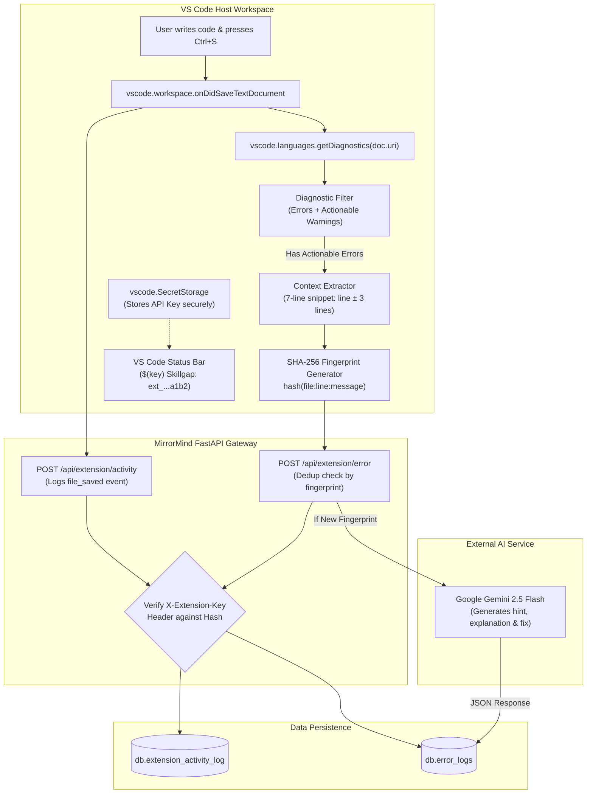
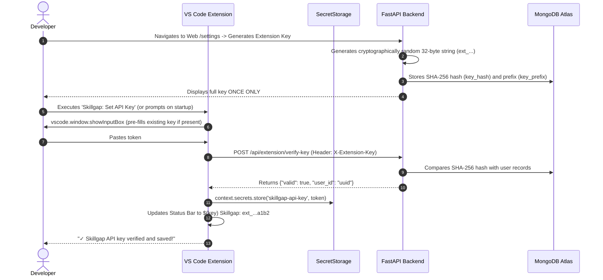

# MirrorMind — VS Code Telemetry Extension (Skillgap Monitor) Specification

## 1. Extension Overview & Architecture

The **Skillgap Monitor** (`vs_extension/src/extension.ts`) is a developer telemetry and real-time AI assistance extension built for Visual Studio Code. It seamlessly bridges the developer's local coding environment with the MirrorMind platform.

### 1.1 Core Mission
1. **Effortless Activity Tracking**: Logs coding sessions and file save activity automatically without interrupting developer workflow.
2. **Intelligent Error Detection**: Listens to compiler and language server diagnostics on file save, filtering out noise and isolating actionable code defects.
3. **Automated AI Bug Healing**: Sends code snippets and error contexts to Google Gemini 2.5 Flash via the MirrorMind backend, generating instant hints, in-depth explanations, and exact code corrections.
4. **Pedagogical Resolution Flow**: Exposes a two-tier learning experience on the web dashboard ("Hint Mode" to encourage problem-solving vs. "Show Fix 🪄" for instant solutions).

---

## 2. Technology Stack & Build Pipeline

* **Runtime**: Visual Studio Code Extension Host API (`^1.85.0`)
* **Language**: TypeScript (`^5.3.0`)
* **HTTP Client**: Native Node.js `http` and `https` modules (zero external runtime npm dependencies for lightweight, sub-second activation).
* **Security & Hashing**: Node.js `crypto` module (SHA-256 fingerprinting).
* **Bundler**: `esbuild` (`esbuild.js`) generating a minified, standalone bundle in `dist/extension.js`.
* **Packaging**: Distributed as a compiled VSIX extension package (`skillgap-monitor-0.0.1.vsix`).

---

## 3. Extension Architecture & Life Cycle



---

## 4. Key Management & Authentication Handshake

The extension implements a zero-leakage security model using VS Code's native `SecretStorage` API:



### 4.1 Status Bar Integration
The extension registers a persistent status bar item on the bottom right:
* **Configured & Valid**: Shows `$(key) Skillgap: ext_a1...9f2b` (masked). Tooltip shows active server URL. Clicking it opens the configuration menu.
* **Unconfigured**: Shows `$(warning) Skillgap: No API Key` with a warning background color, alerting the developer that telemetry is paused.

---

## 5. Diagnostic Filtering & Context Extraction Engine

When a text document is saved, the extension parses all active language server diagnostics for that file. Rather than transmitting all minor notices, it applies strict actionable filtering:

### 5.1 Severity Filtering Rules
1. **Always Included**: Any diagnostic with `severity === DiagnosticSeverity.Error` (syntax errors, missing modules, type errors, parser failures).
2. **Actionable Warnings**: Warnings are checked against an explicit allow-list of critical warning codes:
   - `reportundefinedvariable`
   - `reportundefinedname`
   - `reportunboundvariable`
   - `reportgeneraltypeissues`
   - `reportargumenttype`
   - `reportcallissue`
   - `reportattributeaccessissue`
   - `reportindexissue`
   - `reportoptionalmemberaccess`
3. **Explicitly Excluded**: Harmless warnings such as unused imports (`unused`), formatting hints, or stylistic warnings.

### 5.2 Context Window Extraction (`code_context`)
To allow the AI to accurately diagnose the root cause without uploading entire proprietary repositories, the extension extracts a focused 7-line snippet centered on the error:
$$\text{startLine} = \max(0, \text{errorLine} - 3)$$
$$\text{endLine} = \min(\text{totalLines} - 1, \text{errorLine} + 3)$$

```typescript
const minLine = Math.max(0, startLineIdx - 3);
const maxLine = Math.min(doc.lineCount - 1, startLineIdx + 3);
const contextLines = [];
for (let i = minLine; i <= maxLine; i++) {
    contextLines.push(doc.lineAt(i).text);
}
const code_context = contextLines.join('\n');
const full_line = doc.lineAt(startLineIdx).text.trim();
```

---

## 6. SHA-256 Error Fingerprinting & Deduplication

To prevent API flooding when developers repeatedly press `Ctrl+S` while fixing a line, the extension computes a cryptographic fingerprint:

```typescript
const fingerprintInput = `${doc.fileName}:${line}:${message}`;
const fingerprint = crypto
    .createHash('sha256')
    .update(fingerprintInput)
    .digest('hex');
```

* **Backend Behavior**:
  Upon receiving `POST /api/extension/error`, the backend checks `db.error_logs.find_one({"user_id": user_id, "fingerprint": fingerprint})`.
  - **If Found**: Returns immediately with `{"duplicate": true, "hint": cached_hint}`. No external AI call is made.
  - **If New**: Triggers Google Gemini 2.5 Flash, stores the resulting insights, and creates a fresh error record.

---

## 7. Automated AI Healing & Web Dashboard Integration

When a new error is recorded, Gemini 2.5 Flash analyzes the snippet and returns a structured payload:

```json
{
  "hint": "Check the argument types in your calculate_cgpa function call.",
  "explanation": "The function expects a list of floats, but you are passing a raw string.",
  "corrected_block": "cgpa = calculate_cgpa([float(score) for score in scores])"
}
```

### 7.1 Two-Tier Web Resolution Interface (`/extension`)
On the MirrorMind web dashboard, students interact with errors through a deliberate two-tier interface:
1. **Tier 1 (Hint Mode)**: The student sees the file, line number, and Gemini's `hint`. This encourages independent thinking and debugging skills.
2. **Tier 2 ("Show Fix 🪄")**: If stuck, clicking the reveal button opens a modal fetching the full explanation and the syntactically correct code block.
3. **Resolution**: Clicking "Mark as Solved" records whether the student resolved the error using only the `hint` or required the `full_fix`, populating analytical learning metrics.

---

## 8. Extension Configuration & Command Reference

The extension registers four user commands in the VS Code Command Palette (`Ctrl+Shift+P` / `Cmd+Shift+P`):

| Command ID | Title | Description |
|---|---|---|
| `skillgap.setApiKey` | *Skillgap: Set API Key* | Prompts for extension API key, verifies against backend, and saves to SecretStorage. |
| `skillgap.clearApiKey` | *Skillgap: Clear API Key* | Deletes the stored API key and resets the status bar. |
| `skillgap.setServerUrl`| *Skillgap: Set Server URL* | Overrides the backend endpoint (e.g. switching between localhost, ngrok, or production). |
| `skillgap.showStatus` | *Skillgap: Show Status* | Displays current server URL, masked key status, and quick-action menu. |

### 8.1 Configuration Settings (`package.json`)
* **`skillgap.serverUrl`**:
  - Type: `string`
  - Default: `https://dawdlingly-pseudoinsane-pa.ngrok-free.dev`
  - Description: The target MirrorMind backend URL. Can be set to `http://localhost:8000` for local development.
